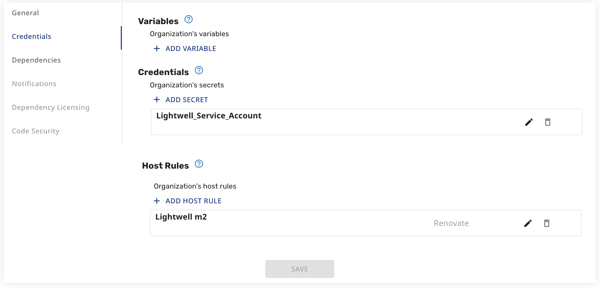
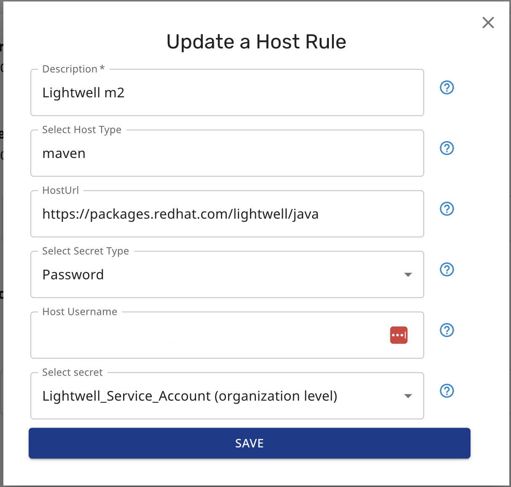

# lightwell-playground

Small Java 25 Maven project for [Red Hat Lightwell](https://console.redhat.com/lightwell) and Trusted Packages. Application code is a single `HelloWorldService`. The dependency set is the fixture: upstream versions pinned so Lightwell skills can move them onto the [Lightwell](https://packages.redhat.com/api/pulp-content/lightwell/) catalogs.

Maven resolves those catalogs through `.m2/settings.xml`:

- Remediated: `https://packages.redhat.com/api/pulp-content/lightwell/java/remediated`
- Validated: `https://packages.redhat.com/api/pulp-content/lightwell/java/validated`

| Dependency | Pinned version | What the skills are expected to do |
|---|---|---|
| `org.json:json` | `20220320` | Upgrade to the next remediated `.rhlw-*` |
| `commons-io:commons-io` | `2.11.0` | Move from Central onto a validated `.rhlw-*` |
| `com.fasterxml.jackson.dataformat:jackson-dataformat-xml` | `2.10.2` | Exclude transitive `com.fasterxml.woodstox:woodstox-core:6.0.3` and promote the remediated build |

## Build

Java 25 (`java=25.0.2.r25-mandrel` in `.sdkmanrc`). Repository downloads need `LIGHTWELL_USERNAME` and `LIGHTWELL_TOKEN`. Catalog version lists and OSV advisories need `LIGHTWELL_CLIENT_ID` and `LIGHTWELL_CLIENT_SECRET`.

Locally, [direnv](https://direnv.net/) loads gitignored `scripts/_creds.sh` (see `.envrc`). That file must export all four variables. The enforcer plugin fails the build when `LIGHTWELL_TOKEN` is empty. In GitHub Actions the same names are repository secrets.

```bash
source scripts/_creds.sh
mvn clean install --batch-mode --settings=.m2/settings.xml
```

## Renovate

[renovate.json](renovate.json) extends `config:best-practices`, enables the Renovate pre-commit hook, and runs early Mondays (UTC). It leaves `org.json:json` enabled and disables `commons-io:commons-io` and `com.fasterxml.jackson.dataformat:jackson-dataformat-xml`, so those two stay as skill fixtures.

Lightwell catalog host rules are configured in the Renovate app:


<br>


## Dependabot

[dependabot](.github/dependabot.yml) mirrors that Monday UTC schedule and the same two ignored artifacts. It registers the remediated and validated catalogs with `LIGHTWELL_USERNAME` and `LIGHTWELL_TOKEN`.

## AI skills

Skills live in [garethahealy/lightwell-skills](https://github.com/garethahealy/lightwell-skills) (`plugins/lightwell/skills`). This repo copies them into gitignored `.cursor/skills`.

| Skill | What it does here |
|---|---|
| `/upgrade-directs` | Bump direct dependencies onto Lightwell |
| `/upgrade-transitives` | Promote remediated transitive `.rhlw-*` fixes |
| `/verify-attestations` | Check local jars against SLSA provenance with cosign |
| `/verify-sboms` | Check local jar SHA-256 values against CycloneDX SBOMs |
| `/add-osv-to-renovate` | Comment remediated OSV advisories on Renovate pull requests |

### Local

```bash
make skills
```

Optional ref: `make skills LIGHTWELL_SKILLS_REF=<branch-or-tag>`. Then **Developer: Reload Window**. Open **Customize → Skills** and confirm the five skills above.

### CI

[Setup lightwell-skills](.github/actions/setup-lightwell-skills/action.yml) runs `make skills`. Skill workflows then run against this `pom.xml`. They pass all four Lightwell secrets. Upgrade Directs, Upgrade Transitives, Verify Attestations, and Verify SBOMs run on `workflow_dispatch` and on pushes to `main` that change `pom.xml`, `.m2/settings.xml`, the workflow, the setup action, or the `Makefile`. Verify Attestations and Verify SBOMs run `mvn clean install` first so the jars are in the local repository. Add OSV to Renovate PRs runs on pull requests opened by `renovate[bot]` and comments with `GH_TOKEN`.

Other workflows on every push and pull request:

- [Build and Analyze](.github/workflows/build.yaml) runs `mvn clean install` with `LIGHTWELL_USERNAME` and `LIGHTWELL_TOKEN`, generates an SBOM, runs CodeQL, and submits a dependency snapshot.
- [Run pre-commit](.github/workflows/precommit-validate.yml) runs the hooks in [.pre-commit-config.yaml](.pre-commit-config.yaml).
- [Scorecard](.github/workflows/scorecard.yml) runs on pushes to `main`, on branch-protection changes, and weekly.
